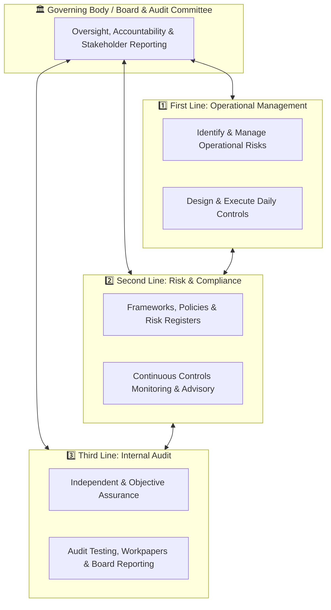

<p align="center">
  
</p>

<p align="center">
  <a href="https://github.com/ishandutta2007/Awesome-Awesome-Awesome"></a>
  <a href="https://discord.gg/jc4xtF58Ve"></a>
  <a href="https://github.com/ishandutta2007/Awesome-Risk-Assurance-Management/stargazers"></a>
  <a href="https://github.com/ishandutta2007/Awesome-Risk-Assurance-Management/network/members"></a>
  <a href="https://github.com/ishandutta2007/Awesome-Risk-Assurance-Management/issues"></a>
  <a href="https://github.com/ishandutta2007/Awesome-Risk-Assurance-Management/blob/main/LICENSE"></a>
  <a href="https://github.com/ishandutta2007/Awesome-Risk-Assurance-Management/pulls"></a>
  <a href="https://github.com/ishandutta2007"></a>
</p>

---

# 🛡️ Awesome Risk & Assurance Management

> **A comprehensive, SEO-optimized, community-curated directory of Integrated Risk Management (IRM), Governance, Risk, and Compliance (GRC), Internal Audit software, and Continuous Controls Assurance tooling.**

Connecting the **First Line** (Operational Management & Control Owners), **Second Line** (Risk, Security & Regulatory Compliance), and **Third Line** (Internal Audit & Independent Assurance) to establish a unified, real-time posture of enterprise risk resilience, regulatory defensibility, and audit readiness.

---

## 📑 Table of Contents

- [🔍 What is Risk & Assurance Management?](#-what-is-risk--assurance-management)
- [📊 Sector Overview & Market Dynamics](#-sector-overview--market-dynamics)
- [🏢 SaaS & Enterprise Hosted Platforms](#-saas--enterprise-hosted-platforms)
- [💻 Open-Source Risk & Assurance Projects](#-open-source-risk--assurance-projects)
  - [⭐ Open-Source Projects Ranked by Community Adoption](#-open-source-projects-ranked-by-community-adoption)
  - [🔬 Detailed Open-Source Project Deep Dives](#-detailed-open-source-project-deep-dives)
- [📐 The Three Lines Model Architecture](#-the-three-lines-model-architecture)
- [🤝 How to Contribute](#-how-to-contribute)
- [⭐ Star History](#-star-history)
- [💖 Support & Sponsoring](#-support--sponsoring)
- [⚖️ Disclaimer & License](#️-disclaimer--license)

---

## 🔍 What is Risk & Assurance Management?

**Risk & Assurance Management** is the disciplined practice of orchestrating enterprise risk registers, internal controls testing, compliance obligations, and independent audit verification across modern organizational ecosystems. 

### Key Pillars
- **🎯 Integrated Risk Management (IRM):** Breaks down silos between enterprise risk (ERM), operational risk (ORM), third-party risk (TPRM), cyber risk, and financial risk to quantify exposures in financial terms.
- **📋 Internal Audit & Workpaper Automation:** Streamlines audit universe management, audit scoping, testing execution, issue management, and reporting to the Board and Audit Committee.
- **⚡ Continuous Controls Monitoring (CCM):** Replaces sample-based point-in-time audits with continuous evidence harvesting and automated telemetry from cloud environments, ERPs, and identity providers.
- **🤖 AI Governance & Regulatory Defensibility:** Assures compliance with emerging frameworks like the EU AI Act, ISO/IEC 42001, and NIST AI RMF alongside established standards (SOX 404, ISO 27001, NIST CSF, HIPAA, PCI DSS, DORA, and NIS2).

---

## 📊 Sector Overview & Market Dynamics

The global **Governance, Risk, and Compliance (GRC)** and **Integrated Risk Management (IRM)** software market is valued between **$15 Billion and $23 Billion**, with the broader platform, advisory, and assurance ecosystem exceeding **$65 Billion**, expanding at a compound annual growth rate (**CAGR**) of **10.6% to 13.6%** through 2030.

### 🌐 Market Structure: Highly Fragmented
- **Niche Specialization vs. Monolithic Suites:** Rather than an entrenched winner-take-all monopoly, the sector remains **highly fragmented** across more than 1,700 vendors. Enterprise organizations routinely deploy specialized best-of-breed solutions for internal audit workpapers, automated SOC 2/ISO compliance testing, third-party risk management (TPRM), IT risk assessments, and Board governance.
- **Private Equity Consolidation Wave:** Tier-one enterprise incumbents (such as Workday, Diligent, Archer, AuditBoard, and MetricStream) are driving aggressive private equity-backed rollups, integrating specialized compliance, ESG, and AI-governance capabilities into unified IRM ecosystems to connect the Three Lines of Defense.

---

## 🏢 SaaS & Enterprise Hosted Platforms

The table below lists leading SaaS and enterprise-hosted Risk & Assurance platforms, **sorted in descending order by Company Size (Valuation / Market Cap / Revenue)**.

| 🏢 Platform / Vendor | 📈 Company Size (Valuation / Revenue) | 💵 Specific Starting Pricing | ⏳ Specific Free Tier / Trial Limits | 🎯 Key Focus & Assurance Capabilities |
| :--- | :--- | :--- | :--- | :--- |
| **[Workday Risk & Assurance](https://www.workday.com/)** | **~$52 Billion Market Cap** (~$9.55B Annual Revenue) | **Starts at ~$100–$150 / user / month** (Base enterprise contracts start at ~$50,000/year; module-dependent) | **No free forever plan**; **30-day free trial** available on Workday Adaptive Planning; enterprise risk & audit modules evaluate via custom vendor PoC sandbox | Unified enterprise ERP controls, automated change logs, auditor-specific dashboards, and continuous segregation of duties (SoD) monitoring. |
| **[Diligent One Platform](https://www.diligent.com/)** | **~$7.0 Billion Valuation** (~$600M+ Annual Revenue; Insight Partners & Clearlake) | **Starts at ~$20,000 / year** (Entry governance/board pack; enterprise risk & internal audit deployments average $50,000–$100,000+/year) | **No free forever plan**; **14-day guided proof-of-concept (PoC)** sandbox available after sales discovery call | Board risk oversight, internal control testing, ESG compliance, audit workpapers, and real-time executive risk telemetry. |
| **[Workiva](https://www.workiva.com/)** | **~$4.7 Billion Market Cap** (~$1.04B Annual Revenue) | **Starts at ~$60,000 / year** (Baseline financial reporting & SOX compliance tier; multi-module suites scale with enterprise volume) | **No free forever plan**; **14-day proof-of-concept sandbox** access granted upon sales qualification (no public self-serve tier) | Connected reporting for SEC filings, SOX compliance, ICFR, audit workpapers, and linked-data audit trail traceability. |
| **[AuditBoard](https://www.auditboard.com/)** | **~$3.0 Billion Valuation** (~$200M+ ARR; acquired by Hg) | **Starts at ~$30,000 / year** (Single module entry for SOX or Internal Audit; full integrated risk bundles scale $60,000–$120,000+/year) | **No free forever plan**; **14-to-30-day guided enterprise PoC** trial environment provided through account executives | Three Lines orchestration, OpsAudit workpaper management, SOXHUB testing automation, TPRM, and dynamic issue remediation. |
| **[Archer IRM](https://www.archerirm.com/)** | **~$2.0 Billion Valuation** (~$220M+ Annual Revenue; acquired by Cinven) | **Starts at ~$50,000 / year** (Baseline risk register & controls monitoring module; full enterprise deployments range $100,000–$250,000+/year) | **No free forever plan**; **30-day structured enterprise sandbox / PoC** evaluation available for qualified enterprise accounts | Quantitative dollar-value risk modeling, multi-tier enterprise risk registers, third-party governance, and audit-ready regulatory trails. |
| **[Riskonnect](https://www.riskonnect.com/)** | **~$1.2 Billion Valuation** (~$161M Annual Revenue; Thoma Bravo & TA Associates) | **Starts at ~$45,000 / year** (Entry risk register tier; comprehensive RMIS & enterprise risk solutions average $150,000–$280,000+/year) | **No free forever plan**; **14-day tailored sandbox environment** available upon enterprise demonstration | Unified Risk Management Information System (RMIS), ERM, incident triage, business continuity, and internal audit tracking. |
| **[Resolver](https://www.resolver.com/)** | **~$800 Million Valuation** (~$82M Annual Revenue; A Kroll Business) | **Starts at ~$15,000 / year** (Incident management & risk register entry tier; full enterprise risk suites run $40,000–$80,000/year) | **No free forever plan**; **14-day interactive trial environment** provided upon request following initial consultation | Operational risk intelligence, regulatory change tracking, internal controls verification, and corporate security incident tracking. |
| **[MetricStream](https://www.metricstream.com/)** | **~$478 Million Valuation** (~$100M+ Annual Revenue; Clearlake Capital & Goldman Sachs) | **Starts at ~$75,000 / year** (Small enterprise entry deployment; mid-market packages range $250,000–$500,000/year) | **No free forever plan**; **30-day structured proof-of-concept (PoC)** pilot with sample corporate controls upon enterprise qualification | AI-powered continuous risk sensing, autonomous evidence harvesting, audit planning, and multi-framework regulatory mapping. |
| **[SAI360](https://www.sai360.com/)** | **~$350 Million Valuation** (~$100M+ Annual Revenue; acquired by STG) | **Starts at ~$25,000 / year** (Entry ethics & compliance module; enterprise GRC suites scale $60,000–$150,000+/year) | **No free forever plan**; **14-day guided sandbox access** provided following enterprise scoping consultation | Ethics & compliance training, automated control assessments, internal audit management, and third-party risk analysis. |
| **[LogicGate Risk Cloud](https://www.logicgate.ai/)** | **~$166 Million Valuation / Funding** (~$49M ARR; backed by Greenspring Associates) | **Starts at ~$13,000–$15,000 / year** (Entry single GRC application; median enterprise spend ~$50,000/year across multiple apps) | **No free forever plan**; **14-day guided proof-of-concept trial** with active workflow sandbox upon request | No-code drag-and-drop risk workflows, automated control testing rationale, GRC AI agents, and extensible REST / MCP connectors. |

---

## 💻 Open-Source Risk & Assurance Projects

Open-source tooling in Risk & Assurance Management offers organizations sovereignty over compliance data, customizable audit evidence pipelines, and transparent policy-as-code automation without vendor lock-in.

### ⭐ Open-Source Projects Ranked by Community Adoption

The following projects are **sorted in descending order by GitHub Star Count**. Each social star badge links directly to that repository's stargazers page:

1. 🌟 **[CISO Assistant](https://github.com/intuitem/ciso-assistant-community)** [](https://github.com/intuitem/ciso-assistant-community/stargazers)  
   *Comprehensive one-stop-shop GRC platform for Risk Management (ISO 27005 & EBIOS RM), AppSec, Compliance & Audit, TPRM, BIA, Privacy, and automated reporting across 200+ global frameworks.*

2. 🌟 **[ComplianceAsCode](https://github.com/ComplianceAsCode/content)** [](https://github.com/ComplianceAsCode/content/stargazers)  
   *The industry-standard security and compliance-as-code engine in SCAP, Ansible, Bash, and InSpec for automated continuous control evaluation, audit hardening, and regulatory verification.*

3. 🌟 **[Comply](https://github.com/strongdm/comply)** [](https://github.com/strongdm/comply/stargazers)  
   *Developer-centric compliance automation framework focused on SOC 2; manages audit policies, procedures, and evidence collection workflows directly within Git.*

4. 🌟 **[Probo](https://github.com/getprobo/probo)** [](https://github.com/getprobo/probo/stargazers)  
   *Self-hosted open-source GRC platform covering risk registers, control tracking, DPIA/TIA, document approval, and audit evidence chains; provides 270+ MCP tools for AI agent workflow automation.*

5. 🌟 **[VerifyWise](https://github.com/verifywise-ai/verifywise)** [](https://github.com/verifywise-ai/verifywise/stargazers)  
   *Centralized AI governance, risk assessment, and LLM evaluation platform supporting EU AI Act, ISO/IEC 42001, and NIST AI RMF with multi-framework control cross-mapping.*

6. 🌟 **[OpenLane](https://github.com/theopenlane/core)** [](https://github.com/theopenlane/core/stargazers)  
   *Modern cloud-native compliance and assurance platform automating SOC 2, ISO 27001, GDPR, and NIST 800-53 evidence harvesting, policy management, and program verification.*

7. 🌟 **[Heimdall 2](https://github.com/mitre/heimdall2)** [](https://github.com/mitre/heimdall2/stargazers)  
   *MITRE's enterprise security control visualizer; enables internal auditors and compliance teams to ingest, compare, track, and report automated security control scan results.*

8. 🌟 **[Unicis Platform](https://github.com/UnicisTech/unicis-platform-ce)** [](https://github.com/UnicisTech/unicis-platform-ce/stargazers)  
   *All-in-one open-source GRC solution for privacy, security, and risk teams; alternative to legacy compliance suites with native ISO 27001, GDPR, SOC 2, and NIST coverage.*

9. 🌟 **[SimpleRisk](https://github.com/simplerisk/code)** [](https://github.com/simplerisk/code/stargazers)  
   *Mature, battle-tested open-source risk management platform delivering risk identification, risk scoring, mitigation planning, review cycles, and compliance framework tracking.*

10. 🌟 **[AuditSym](https://github.com/SUALBA/AuditSym)** [](https://github.com/SUALBA/AuditSym/stargazers)  
    *Offline-first local GRC platform with integrated AI remediation for NIST CSF 2.0, ISO 27001, CIS Controls v8, and COBIT audits, featuring an Impact vs. Effort remediation matrix.*

11. 🌟 **[Cairn](https://github.com/frousselet/cairn)** [](https://github.com/frousselet/cairn/stargazers)  
    *Self-hosted GRC platform enforcing ISO 27005 and EBIOS RM risk management with permissioned state transitions, nonconformity registers, and native REST & MCP servers.*

---

### 🔬 Detailed Open-Source Project Deep Dives

```
┌────────────────────────────────────────────────────────────────────────┐
│                   Open-Source Assurance Stack Overview                  │
├──────────────────┬───────────────────────┬─────────────────────────────┤
│ Core IRM / GRC   │ Controls & Automation │ Specialized AI / Audit      │
├──────────────────┼───────────────────────┼─────────────────────────────┤
│ • CISO Assistant │ • ComplianceAsCode    │ • VerifyWise (AI GRC)       │
│ • SimpleRisk     │ • Comply (SOC 2)      │ • Heimdall 2 (Audit Viewer) │
│ • Probo (MCP)    │ • OpenLane            │ • AuditSym (Offline AI GRC) │
│ • Cairn          │ • Unicis Platform     │                             │
└──────────────────┴───────────────────────┴─────────────────────────────┘
```

- **[CISO Assistant (intuitem)](https://github.com/intuitem/ciso-assistant-community)**  
  Built with Python/Django and modern Vue.js frontend; implements automated risk scoring via ISO 27005 and EBIOS RM. Enables continuous third-party risk assessments (TPRM), privacy impact analyses (DPIA), and automatic mapping across 200+ regulatory frameworks. Single Docker container deployment.

- **[ComplianceAsCode (ComplianceAsCode/content)](https://github.com/ComplianceAsCode/content)**  
  Maintained by leading security teams to provide automated continuous compliance checking. Generates SCAP benchmarks, Ansible playbooks, and InSpec profiles from high-level YAML definitions, allowing organizations to maintain continuous compliance audit trails directly in CI/CD pipelines.

- **[Comply (StrongDM)](https://github.com/strongdm/comply)**  
  Treats compliance and controls verification as code. Generates SOC 2 audit readiness workpapers, tickets compliance milestones into Jira/GitHub, and manages policies via markdown version control.

- **[Probo (getprobo)](https://github.com/getprobo/probo)**  
  Self-hostable ISC-licensed platform built for modern engineering teams. Features 270+ MCP (Model Context Protocol) tools for AI agents, `prb` CLI, GraphQL APIs, and immutable audit logs. Ideal for orchestrating automated compliance pipelines.

- **[VerifyWise (verifywise-ai)](https://github.com/verifywise-ai/verifywise)**  
  Purpose-built for organizations building or operating AI systems. Provides automated risk assessments, supplier evaluation, and control mapping across the EU AI Act, ISO/IEC 42001, and the NIST AI Risk Management Framework (AI RMF).

- **[SimpleRisk (simplerisk)](https://github.com/simplerisk/code)**  
  One of the longest-running open-source risk management platforms. Features dynamic risk heatmaps, quantitative risk assessments, mitigation workflows, and predefined control frameworks (NIST, CIS, ISO).

---

## 📐 The Three Lines Model Architecture

A mature Risk and Assurance framework operationalizes the **IIA Three Lines Model** into digital workflows:



- **1️⃣ First Line (Operational Management):** Business unit leaders and control owners execute operations while mitigating and reporting risks in daily workflows.
- **2️⃣ Second Line (Risk & Compliance):** Enterprise risk managers and compliance officers provide policy frameworks, tools, oversight, and continuous monitoring.
- **3️⃣ Third Line (Internal Audit):** Independent internal audit teams deliver objective assurance on the effectiveness of governance, risk management, and first/second line controls to the Board.

---

## 🤝 How to Contribute

Contributions from risk professionals, internal auditors, compliance officers, and open-source developers are warmly encouraged!

1. 🍴 **Fork** the repository: `https://github.com/ishandutta2007/Awesome-Risk-Assurance-Management`
2. 🌿 **Create a Branch**: `git checkout -b feature/add-new-tool`
3. 📝 **Add or Update Entries**: Follow the established tabular format for SaaS platforms or list format with social star badges for open-source tools.
4. 🔍 **Verify Data Quality**: Ensure exact starting prices, specific free tier/trial limits, and accurate links.
5. 🚀 **Submit a Pull Request**: Provide a concise summary of the addition or revision.

For more awesome curated resources, visit [Awesome-Awesome-Awesome](https://github.com/ishandutta2007/Awesome-Awesome-Awesome)!

---

## ⭐ Star History

[](https://star-history.dera.page/#ishandutta2007/Awesome-Risk-Assurance-Management&type=date&legend=top-left)

---

## 💖 Support & Sponsoring

Thank you for visiting and utilizing **Awesome Risk & Assurance Management**! If this curated repository helps streamline your enterprise risk assessments, audit preparation, or compliance research, please consider supporting the project:

- ⭐ **Star this repository** on GitHub to amplify its reach and community visibility.
- 🍴 **Fork and contribute** to keep entries fresh and accurate.
- 📢 **Share this repository** with your colleagues, audit committees, and infosec teams.
- ☕ **Sponsor or buy a coffee** to fuel ongoing curation via the [GitHub Sponsor Dashboard](https://github.com/sponsors/ishandutta2007).

---

## ⚖️ Disclaimer & License

- **Disclaimer:** This repository is an independent, community-curated research directory and does not constitute formal legal, compliance, or financial audit advice. Product names, logos, and brands are property of their respective owners.
- **License:** Released under the [MIT License](LICENSE).
